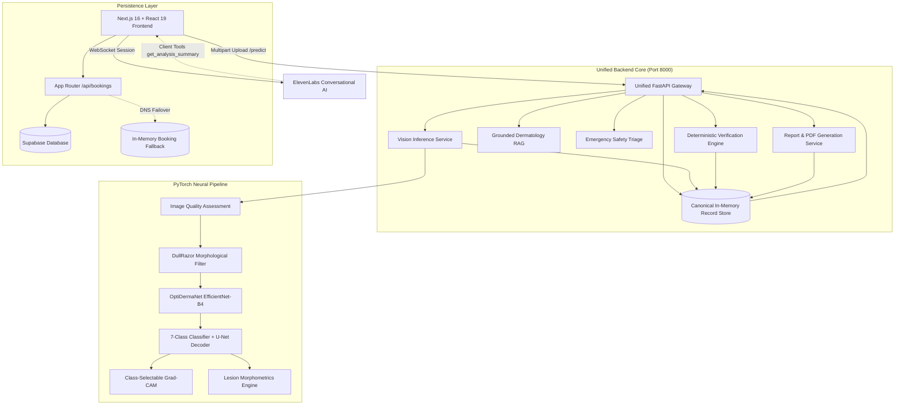
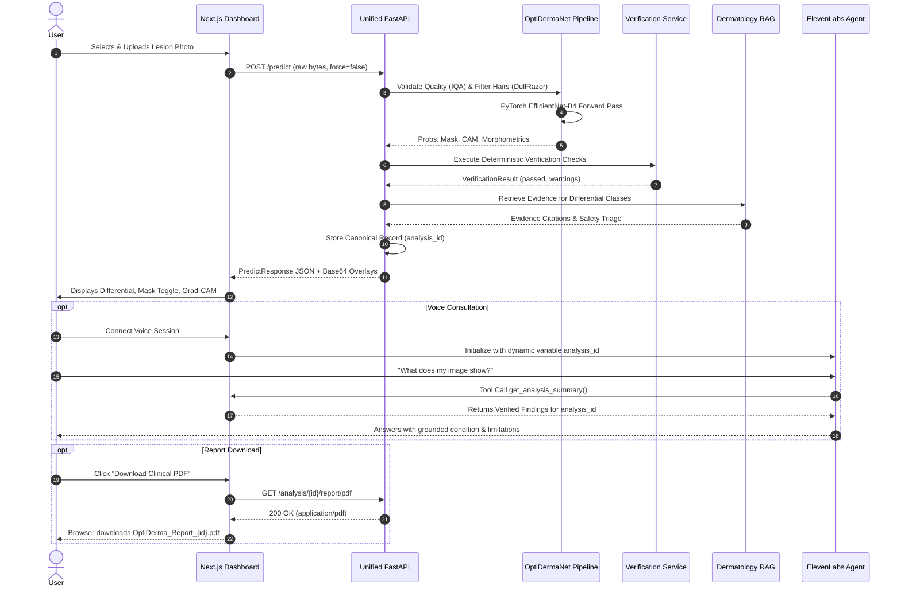
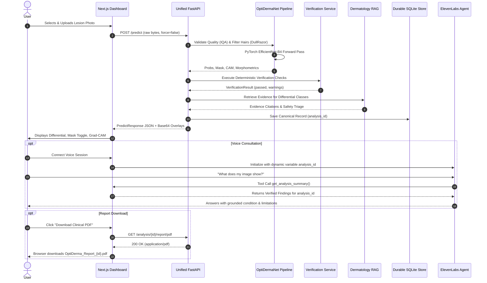

# OptiDerma — End-to-End System Architecture

**Document Version**: 2.0.0  
**Effective Date**: 15 October 2026  
**System Classification**: Research-Grade Dermatology Decision-Support Platform  

---

## 1. Architectural Philosophy & Guiding Principles

OptiDerma is built around five fundamental engineering and clinical AI principles:

1. **Truthful Multimodal Inference (Zero Mock Data)**: Every prediction, segmentation mask, and explainability heatmap rendered by the UI originates from the genuine, loaded PyTorch checkpoint (`optiderma_best_model.pth`). If a component fails or model weights are missing, the system explicitly reports degraded or unavailable state rather than fabricating pleasant approximations.
2. **Canonical Analysis Identification**: All user-facing components—Next.js dashboard, LesionCanvas, ElevenLabs Voice Assistant, and Report Generator—reference a single immutable `analysis_id` (UUIDv4). The voice assistant answers questions strictly grounded in the same record displayed visually.
3. **Deterministic Independent Verification**: LLM outputs and neural network inferences are never accepted unconditionally. An independent, rule-based verification agent executes mathematical invariant tests before results can be consumed.
4. **Non-Destructive Image Processing**: Raw image bytes are preserved bit-for-bit without client-side lossy recompression. Preprocessing (IQA, DullRazor hair removal) produces explicit diagnostic masks and before/after layers without overwriting the original dermoscopy evidence.
5. **Medical Safety & Emergency Triage**: Decision-support systems must communicate diagnostic uncertainty, disclose model calibration status, avoid prescriptive dosing, and provide immediate emergency guidance upon encountering red-flag symptoms.

---

## 2. High-Level Component Topology

---

## 3. Core Subsystems

### 3.1 Unified FastAPI Gateway (`backend/app/main.py`)
Previously divided between `model/server.py` and `backend/app/main.py`, the backend has been unified into a single asynchronous service exposing:

| Endpoint | Method | Purpose | Input / Output |
| :--- | :--- | :--- | :--- |
| `/health` | `GET` | Container liveness check | `{"ok": true}` |
| `/ready` | `GET` | Service readiness check (verifies model weights, device, memory) | `{"ready": true, "model_checkpoint": "..."}` |
| `/predict` | `POST` | Primary inference pipeline (backward-compatible with Next.js client) | `multipart/form-data` -> `PredictResponse` |
| `/analyze` | `POST` | Multi-agent orchestrated analysis endpoint | `multipart/form-data` -> Canonical Analysis Record |
| `/analysis/{id}` | `GET` | Retrieve cached canonical analysis record | UUID -> `PredictResponse` |
| `/analysis/{id}/verify`| `POST` | Re-run or query deterministic verification checks | UUID -> `VerificationResult` |
| `/analysis/{id}/report`| `GET` | Retrieve Patient or Technical JSON report | `?report_type=patient\|technical` |
| `/analysis/{id}/report/pdf`| `GET` | Download native binary PDF clinical report | Binary `application/pdf` |

### 3.2 PyTorch Neural Architecture (`model/model_pipeline.py`)
- **Backbone**: EfficientNet-B4 pre-trained on ImageNet, adapted for dermoscopy feature extraction.
- **Classification Head**: Adaptive average pooling $\rightarrow$ Linear(1792, 448) $\rightarrow$ SiLU $\rightarrow$ Dropout(0.3) $\rightarrow$ Linear(448, 256) $\rightarrow$ SiLU $\rightarrow$ Linear(256, 7).
- **Segmentation Head**: Full 4-stage convolutional U-Net decoder utilizing skip-connections from intermediate EfficientNet feature maps (`blocks[1]`, `blocks[2]`, `blocks[3]`, `blocks[5]`), terminating in `seg_out` (Conv2D 16 $\rightarrow$ 1, Sigmoid).
- **Classes**: 7-class differential diagnosis from HAM10000/ISIC:
  1. `akiec`: Actinic Keratosis / Intraepithelial Carcinoma
  2. `bcc`: Basal Cell Carcinoma
  3. `bkl`: Benign Keratosis (seborrheic keratosis, solar lentigo)
  4. `df`: Dermatofibroma
  5. `mel`: Melanoma
  6. `nv`: Melanocytic Nevus
  7. `vasc`: Vascular Lesion

### 3.3 DullRazor Hair Removal Service (`model/preprocessor.py`)
DullRazor isolates thin hair artifacts without eroding circular lesion borders:
- **Multi-Angle Linear Black-Hat**: Morphological closing with line-structuring elements at $0^\circ, 45^\circ, 90^\circ, 135^\circ$ (length 17 px).
- **Geometric False-Positive Filtering**: Candidate components must satisfy:
  - Stroke thickness $T \le 10\text{ px}$.
  - Bounding box extent $E \le 0.11$ (ruling out compact circular lesion edges).
  - Aspect ratio $\text{AR} \ge 2.5$.
- **Telea Inpainting**: Fast-marching inpainting ($R = 3\text{ px}$) preserves texture surrounding follicles.
- **Diagnostic Metrics**: Returns `hair_strands_detected`, `hair_area_pixels`, `hair_coverage_pct`, and before/after inpainting PSNR.

### 3.4 Explainability & Grad-CAM (`model/model_pipeline.py`)
- **Hook-Free Direct Autograd**: Target feature activations $A^k$ and gradients $w_k = \frac{1}{Z}\sum_i \sum_j \frac{\partial y^c}{\partial A_{i,j}^k}$ are collected via PyTorch `register_forward_hook` and backward autograd.
- **Selective Class Attention**: Unlike baseline implementations locked to the top-1 class, OptiDerma supports explicit `target_class` queries, enabling clinicians to contrast attention between Melanoma vs Benign Nevus on the same lesion.
- **Sanity Validation**: Gradient norms are verified non-zero and non-NaN before activation heatmaps are normalized.

### 3.5 Deterministic Verification Engine (`backend/app/services/verification_service.py`)
Automated verification tests run independently of model output to ensure integrity:
1. **Simplex Probability Invariant**: $\left|\sum_{i=1}^7 P(x_i) - 1.0\right| \le 10^{-3}$.
2. **Finite Value Verification**: No `NaN` or `Inf` in logits or calibrated probabilities.
3. **Monotonic Top-3 Differential**: Verifies $P(\text{top}_1) \ge P(\text{top}_2) \ge P(\text{top}_3)$.
4. **Isoperimetric Inequality**: For detected lesion boundaries, verifies circularity compactness $\frac{P^2}{4\pi A} \ge 1.0$.
5. **Non-Degenerate Segmentation**: Masks covering $< 0.1\%$ or $> 95\%$ of image area trigger verification warnings.
6. **IQA Conformance**: Flags blur (Laplacian variance $< 100$), severe glare, or extreme underexposure.

### 3.6 Grounded Dermatology RAG & Safety Triage (`backend/app/rag/dermatology_rag.py`)
- **Literature Index**: Verified clinical guidelines from the American Academy of Dermatology (AAD), British Association of Dermatologists (BAD), and International Dermoscopy Society (IDS).
- **Source Attribution**: Every retrieved recommendation includes source title, organization, publication year, and guideline URL.
- **Emergency Red-Flag Triggers**: Deterministic regex and semantic guards detect critical presentations (e.g., sudden rapid bleeding, ulceration, systemic fever) and immediately inject emergency triage directives.

### 3.7 Voice Assistant Grounding (`components/voice-assistant.tsx`)
- Uses `@elevenlabs/react` with agent ID `agent_6601m418gdvxe7zr1zksvnmtb3f1`.
- **Client Tools**:
  - `get_analysis_summary`: Delivers canonical `analysis_id`, primary diagnosis, confidence, and risk.
  - `get_highlighted_area_explanation`: Explains Grad-CAM attention regions and clinical focus.
  - `get_model_limitations`: Communicates model bounds, calibration disclaimers, and need for clinical biopsy.
  - `get_verification_status`: Reports whether the automated verifier passed the output.
  - `get_available_slots` & `book_appointment`: Preserved for dermatologist scheduling.

### 3.8 Dual-View Clinical Report & PDF Generator (`backend/app/services/report_service.py`)
- **Patient-Friendly Report**: Plain-language condition explanation, uncertainty disclosure, ABCDE observations, and practical next steps.
- **Technical Research Report**: Model metadata, checkpoint hash, tensor shapes, morphometric measurements (area, perimeter, asymmetry indices), verification audit log, and RAG literature citations.
- **Native PDF Export**: ReportLab vector layout rendering a professional, downloadable 2-page clinical summary.

---

## 4. End-to-End Sequence Diagram

---

### 3.9 Care Connect & Verified Dermatologist Directory (`backend/app/services/care_service.py`)
- **Verified Facility Index**: Curated directory of tertiary hospital dermatology departments (e.g., AIIMS New Delhi, PGIMER Chandigarh, Victoria Hospital Bengaluru, CMC Vellore) and national tele-dermatology networks (eSanjeevani).
- **Honest Location Matching**: Strict PIN code and postal circle matching. Never fabricates fake clinics, doctor names, or ratings when searching unlisted or non-existent PIN codes.
- **Consultation Preparation Packets**: Generates structured, patient-customized visit sheets with visual findings, differential possibilities, and tailored questions for the dermatologist.
- **Pending Appointment Booking**: In-clinic visit requests default strictly to `"Pending"` status for human clinic coordinator confirmation.

### 3.10 Dual-Tier Durable Persistence Architecture (`backend/app/services/persistence_service.py`)
- **Tier 1 (Authoritative Local Store)**: SQLite 3 database (`backend/data/optiderma_persistence.db`) running in Write-Ahead Logging (`WAL`) mode with schema mirroring. Preserves all canonical analyses, XAI vectors, verification logs, multi-turn conversations, and appointment requests across server restarts.
- **Tier 2 (Cloud PostgreSQL Sync)**: Supabase PostgREST synchronization when remote database tables are migrated and accessible. Probes status dynamically via `/persistence/status` (`pending_migration`, `connected`, `unreachable`).
- **Tier 3 (In-Memory Session Cache)**: Low-latency in-memory dictionary for active user requests.

### 3.11 8-Node Controlled Agentic Workflow (`backend/app/agents/optiderma_agent.py`)
- **Node 1 (Context Resolver)**: Resolves user ID, conversation session ID, and active canonical analysis ID.
- **Node 2 (Intent Classifier)**: Classifies input into emergency triage, XAI explanation, morphometrics explanation, differential comparison, or general skin education.
- **Node 3 (Tool Executor)**: Accesses model logits, uncalibrated softmax scores, and native pixel morphometrics.
- **Node 4 (Hybrid RAG Retriever)**: Combines keyword BM25 and TF-IDF cosine similarity over 13 verified international clinical dermatology guidelines.
- **Node 5 (Domain Safety Guard)**: Confines responses to dermatological topics; abstains with honest disclosures when literature lacks relevant evidence.
- **Node 6 (Constrained Answer Generator)**: Drafts responses grounded in indexed evidence with explicit inline citations (`[CIT-X]`).
- **Node 7 (Citation Validator)**: Strips or replaces unverified citation tags to prevent hallucinated references.
- **Node 8 (Multi-Turn Durable Persistence)**: Records message turns, user queries, assistant replies, and citation metadata to the durable SQLite store.

---

## 4. End-to-End Sequence Diagram

---

## 5. Security & Privacy Architecture

- **OWASP Response Headers**: Every response enforces:
  - `Content-Security-Policy: default-src 'self'; frame-ancestors 'none';`
  - `X-Content-Type-Options: nosniff`
  - `X-Frame-Options: DENY`
  - `X-XSS-Protection: 1; mode=block`
  - `X-Request-ID: <uuid>` (unique distributed tracing identifier)
- **Rate Limiting & Origin Verification**:
  - Next.js API routes enforce host-origin verification (`lib/server-guard.ts`) and fixed-window per-IP rate limiting (12 requests / 10 min for voice sessions).
  - FastAPI middleware enforces a 300 req/min global IP throttle and a 20 MB maximum payload limit.
- **Prompt Injection & Sanitization**: Regex and semantic checks sanitize inputs containing script tags, markdown escapes, or prompt overrides (`Ignore all previous instructions`).
- **Server-Side Credential Isolation**: ElevenLabs API keys, Groq tokens, and Supabase keys are retained exclusively in backend environment variables (`.env.local`). Never surfaced to client bundles.
- **Input Validation**: Strict limits of $20\text{ MB}$ max payload, whitelist MIME types (`image/jpeg`, `image/png`, `image/webp`), and dimension bounds ($64\text{ px} \le \text{dim} \le 4096\text{ px}$).
